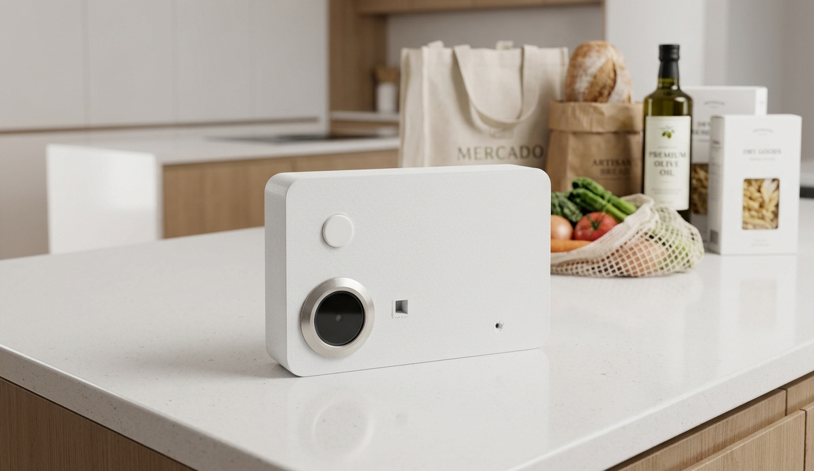

# Improved Scanner ESPHome

A DIY shopping scanner powered by ESPHome and Home Assistant. Scan an empty package before throwing it away, or tap an NFC tag for unpackaged items such as bread and fruit, to tell Home Assistant what needs replacing.

## Materials

- [ESP32-S3 N16R8](https://aguacatec.es/ha-devices/esp32-s3-n16r8/)
- [GM60 barcode and QR scanner](https://aguacatec.es/ha-devices/escaner-gm60/)
- [PN532 NFC reader](https://aguacatec.es/ha-devices/modulo-pn532/)
- [Passive buzzer](https://aguacatec.es/ha-devices/zumbador/)

You will also need a push button, wires, USB power and NFC tags for items without barcodes.

## How to use

1. Connect the components using the GPIO assignments in [`improved-scanner.yaml`](improved-scanner.yaml). Set the PN532 to I²C mode.
2. Add your Wi-Fi credentials to `secrets.yaml`, replace the API encryption key, OTA password and fallback hotspot password in the YAML, then compile and install it with ESPHome over USB.
3. Add the device to Home Assistant through the ESPHome integration, using the same API encryption key.
4. Configure your shopping list integration or an automation to match barcode values and NFC tag IDs to products and add them to your list. This repository provides the scanner firmware; the shopping list logic is configured separately.
5. Place the scanner near your bin. Scan empty packages or tap the NFC tag assigned to an item when it runs out. A beep and green light confirm each reading. Press the button to turn the white light on or off for better visibility.
